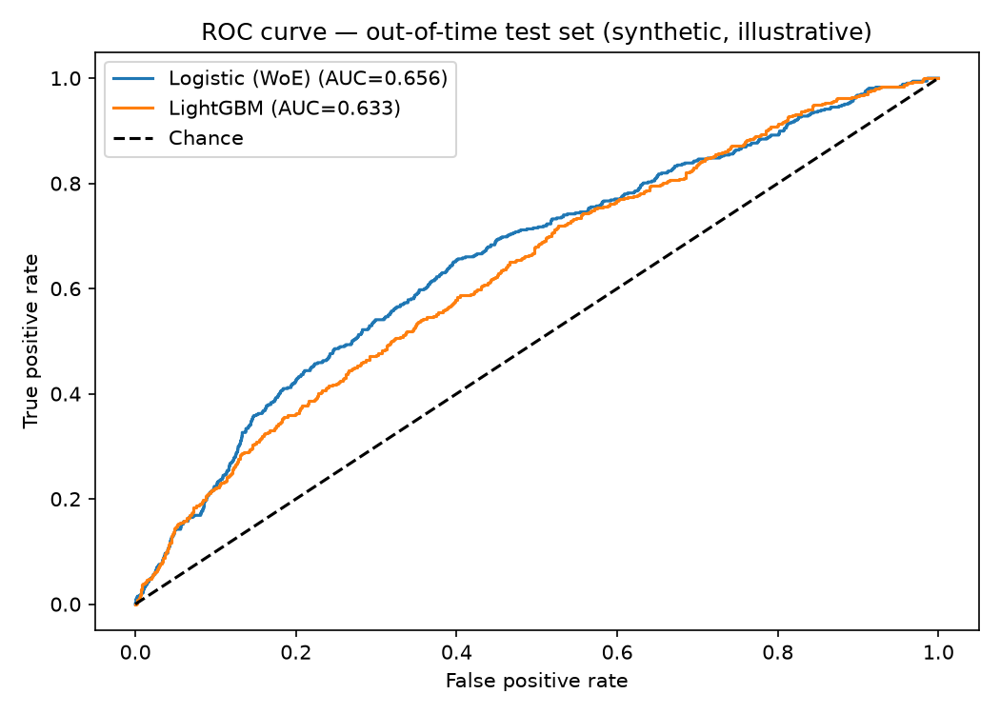
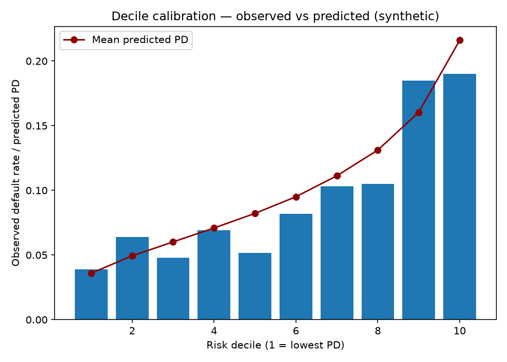
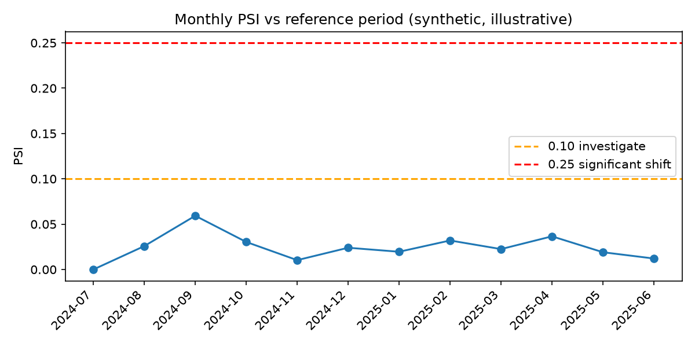

# CreditRisk-IFRS9 — Gestión de cartera, análisis de cosechas y pérdida esperada

[](https://www.python.org)
[](sql/)
[](LICENSE)

[Read the English version](README.md)

Analítica de riesgo de crédito de punta a punta: auditoría de cartera en SQL
(curvas de cosechas y matrices de transición), scorecard de probabilidad de
incumplimiento (PD) con Weight of Evidence, pérdida esperada bajo la lógica de
IFRS 9 / Basilea y monitoreo de estabilidad poblacional (PSI). Corre de punta
a punta con datos sintéticos realistas — sin descargar nada — y documenta cómo
reproducirlo con datos reales (LendingClub / Home Credit).
**Todas las métricas de este README provienen de datos sintéticos y son
ilustrativas**: muestran que el pipeline funciona y cómo se interpretan los
resultados, no el desempeño de ninguna cartera real.

## Qué hace este proyecto

```
préstamos sintéticos ──► auditoría SQL ──► scorecard WoE ──► pérdida esperada ──► monitoreo
 (20 000 préstamos)      (cosechas y         (logística vs        EL = PD×LGD×EAD      (PSI, mensual)
                          roll rates)         LightGBM)           + estrés macro
```

| Etapa | Pregunta que responde | Artefacto |
|---|---|---|
| Auditoría de cartera (SQL) | ¿La mora es una mala cosecha o un mal mes? ¿Qué tan rápido ruedan los préstamos entre buckets de DPD? | `sql/01–03` |
| Scorecard de PD | ¿Qué acreditados incumplen en 12 meses y está calibrada la probabilidad? | `src/woe.py`, `src/train_pd.py` |
| Pérdida esperada (IFRS 9) | ¿Cuánto debe provisionarse, por grado y bajo estrés? | `src/expected_loss.py` |
| Monitoreo | ¿La población calificada se está alejando de la población de entrenamiento? | `src/monitoring.py` |

## Arquitectura

```
CreditRisk-IFRS9/
├── README.md / README.es.md
├── LICENSE (MIT)
├── requirements.txt
├── Makefile / run_all.sh          # ejecución de punta a punta con un comando
├── .github/workflows/ci.yml       # pytest en cada push (Python 3.11)
├── sql/
│   ├── 01_vintage_analysis.sql    # curvas de cosechas por MOB
│   ├── 02_roll_rates.sql          # matrices de transición de DPD
│   └── 03_portfolio_kpis.sql      # KPIs mensuales del paquete de gestión
├── src/
│   ├── generate_synthetic.py      # DGP sintético realista (documentado)
│   ├── woe.py                     # binning WoE / IV
│   ├── train_pd.py                # logística calibrada vs LightGBM, split OOT
│   ├── expected_loss.py           # EL = PD × LGD × EAD + escenarios de estrés
│   ├── monitoring.py              # PSI por mes
│   ├── utils.py                   # KS, Gini, tabla de deciles
│   └── run_pipeline.py            # orquesta los pasos 1 → 4
├── notebooks/
│   └── 01_eda_vintage.ipynb       # notebook ejecutado (con salidas)
├── scripts/
│   └── check_sql.py               # valida sql/*.sql en SQLite
├── tests/
│   ├── test_woe.py                # pruebas de WoE / IV
│   ├── test_expected_loss.py      # pruebas de EL, estrés y PSI
│   └── test_sql.py                # pruebas de validación SQL (vía check_sql)
├── docs/images/                   # gráficas incrustadas en los READMEs
├── data/synthetic/                # generado (ignorado por git, regenerable)
└── outputs/                       # JSON de métricas, CSV de deciles, gráficas PNG
```

## Inicio rápido

```bash
git clone https://github.com/carlosedurampz-sketch/CreditRisk-IFRS9.git && cd CreditRisk-IFRS9
bash run_all.sh            # crea .venv, instala dependencias, corre pruebas + pipeline
# — o paso a paso —
python3 -m venv .venv && .venv/bin/pip install -r requirements.txt
.venv/bin/python -m pytest tests/ -q
.venv/bin/python -m src.run_pipeline
```

Tiempo esperado: ~1–2 minutos (20 000 préstamos / 500 000 snapshots mensuales).
Las salidas quedan en `outputs/`: `pd_metrics.json`, `deciles_logistic.csv`,
`expected_loss.json`, `el_by_grade.csv`, `el_stress.csv`, `psi_monthly.csv`,
y `roc_curve.png`, `decile_calibration.png`, `psi_monthly.png`.

Para validar el SQL por separado (SQLite, solo biblioteca estándar):

```bash
.venv/bin/python scripts/check_sql.py
# loaded loans: 20,000 rows / loaded snapshots: 500,000 rows
# OK 01_vintage_analysis.sql / OK 02_roll_rates.sql / OK 03_portfolio_kpis.sql
```

La misma validación corre en CI a través de `tests/test_sql.py`, que ejecuta
cada consulta de `sql/` contra un fixture pequeño en SQLite en memoria y
verifica que cada sentencia corra y devuelva filas.

## Datos

**Por defecto (sin descargar nada).** El pipeline genera datos sintéticos con
un proceso generador documentado en `src/generate_synthetic.py`: 20 000
préstamos originados mensualmente entre 2022-01 y 2025-06, con el grado
asignado a partir del bureau score, la tasa de interés por grado y un log-odds
latente de incumplimiento a 12 meses impulsado por DTI, utilización
revolvente, bureau score, moras, antigüedad laboral y tasa. Los snapshots
mensuales de mora (MOB 0–24) siguen un proceso tipo Markov en el que 90+ DPD
es casi absorbente. Tasa global de incumplimiento a 12 meses: **10.08%**
(sintética).

**Con datos reales.** Los datasets reales sugeridos son
[LendingClub](https://www.kaggle.com/datasets/wordsforthewise/lending-club)
(préstamos aceptados, `loan_status` → incumplimiento) y
[Home Credit Default Risk](https://www.kaggle.com/c/home-credit-default-risk)
(`application_train.csv` → `TARGET`). Para usar uno: expórtalo a
`data/synthetic/loans.csv` con las columnas `loan_id, origination_month, grade,
term_months, loan_amnt, int_rate, annual_income, dti, revol_util, bureau_score,
emp_length_years, delinq_2yrs, purpose, default_12m, lgd_realised` (y los
snapshots mensuales a `snapshots.csv` con `loan_id, origination_month,
months_on_book, dpd_bucket, dpd_days, outstanding_balance`), y luego corre
`python -m src.run_pipeline --skip-generate`. El binning WoE, el split y las
métricas son agnósticos al dataset; solo hay que adaptar el mapeo de columnas,
y la estimación de LGD en `expected_loss.py` debería reemplazarse por un modelo
de LGD de workout sobre recuperaciones reales (ver Limitaciones).

## Metodología

### 1. Auditoría de cartera en SQL

- **Análisis de cosechas** (`sql/01`): para cada mes de originación y meses
  en libros, la proporción en 30+ y 90+ DPD y la tasa *acumulada* de 90+,
  construida con `SUM() OVER (PARTITION BY origination_month ORDER BY
  months_on_book)`. Una cosecha por encima de sus vecinas al mismo MOB
  señala suscripción; un alza simultánea en todas las cosechas señala
  macro/cobranza.
- **Roll rates** (`sql/02`): matriz de transición empírica entre buckets de
  DPD, a partir de un self-join del mes `t` con el mes `t+1`. Las filas
  suman 100%.
- **KPIs** (`sql/03`): tamaño de cartera, tasa de incumplimiento a 12 meses
  por cosecha y por grado, stock de mora y concentración en grados D–G.

### 2. Scorecard de PD — regresión logística WoE vs LightGBM

Para una variable $x$ dividida en bins $b$, el Weight of Evidence y el
Information Value son

$$\mathrm{WoE}_b = \ln\left(\frac{\%\,\text{buenos en } b}{\%\,\text{malos en } b}\right),
\qquad \mathrm{IV} = \sum_b (\text{buenos\%}_b - \text{malos\%}_b)\cdot \mathrm{WoE}_b$$

El **modelo campeón es la regresión logística calibrada sobre features WoE**:
monótona, interpretable y auditable línea por línea — el estándar que un
regulador puede revisar. Está envuelta en `CalibratedClassifierCV`
(escalado sigmoide/Platt), porque una PD que alimenta la pérdida esperada
debe ser una *probabilidad*, no solo un ranking. **LightGBM** es el retador
con features crudos.

Crucialmente, el split es **out-of-time**, no aleatorio: entrenamiento con
préstamos originados ≤ 2024-06 (14 373 préstamos, 10.36% de incumplimiento),
prueba con los originados después (5 627 préstamos, 9.37% de
incumplimiento). Un split aleatorio filtraría el futuro al entrenamiento e
inflaría todas las métricas.

La discriminación se mide con el estadístico de Kolmogorov–Smirnov

$$\mathrm{KS} = \max_s \left| F_{\text{malos}}(s) - F_{\text{buenos}}(s) \right|$$

y Gini $= 2\cdot\mathrm{ROC\text{-}AUC} - 1$, además de PR-AUC (más
informativo que ROC-AUC bajo desbalance de clases) y el Brier score para
calibración.

### 3. Pérdida esperada (IFRS 9 / Basilea)

Para cada exposición:

$$EL = PD \times LGD \times EAD$$

- **PD**: PD a 12 meses del scorecard calibrado.
- **LGD**: LGD realizada media por grado en los préstamos incumplidos de
  entrenamiento (A ≈ 35% → G ≈ 65% en los datos sintéticos), con piso de
  5% / techo de 95%.
- **EAD**: saldo vigente al mes 12 según los snapshots (monto de
  originación cuando no hay snapshot).

Los escenarios de estrés escalan la PD y desplazan la LGD, como en un stress
test bancario: **base** (PD ×1.0), **adverso** (PD ×1.5, LGD +10 pp),
**severo** (PD ×2.0, LGD +20 pp). La clasificación por etapas (Stage 1/2/3)
*no* está implementada — ver Limitaciones; la PD a 12 meses se usa para
todas las exposiciones y la simplificación se declara, no se oculta.

### 4. Monitoreo — Population Stability Index

$$\mathrm{PSI} = \sum_b (\text{actual\%}_b - \text{esperado\%}_b)\cdot
\ln\left(\frac{\text{actual\%}_b}{\text{esperado\%}_b}\right)$$

Los bordes de deciles se fijan en el periodo de referencia (2024-07); cada
mes posterior se compara contra él. Umbrales: PSI < 0.10 estable, 0.10–0.25
investigar, > 0.25 cambio significativo / considerar recalibración.

## Resultados — datos sintéticos, ilustrativos ⚠️

> **Léase primero.** Cada número siguiente fue producido por
> `python -m src.run_pipeline` (semilla 42, 20 000 préstamos sintéticos) y es
> reproducible desde `outputs/`. Demuestra que el pipeline funciona y cómo
> leer las salidas. **No es el desempeño de una cartera real** y no debe
> citarse como tal.

### Auditoría de cartera (SQL)

La tasa de incumplimiento por grado es monótona, como debe ser una
calificación sana (tabla completa en el notebook; A 5.53% → G 15.41% de
incumplimientos a 12 meses). La cosecha 2022-01 alcanza 1.02% en 90+ DPD a
MOB 3, 4.29% a MOB 6 y 12.27% a MOB 12 — las curvas suben y luego se
aplanan, lo que justifica la ventana de incumplimiento a 12 meses.

**Matriz de roll rates** (% de préstamos, filas = bucket este mes → columnas = próximo mes):

| De \ A | Current | 30 | 60 | 90+ |
|---|---:|---:|---:|---:|
| Current | **91.9** | 7.7 | 0.0 | 0.4 |
| 30 | 44.4 | 46.6 | 8.5 | 0.5 |
| 60 | 0.0 | 43.8 | 45.5 | 10.7 |
| 90+ | 0.0 | 0.0 | 2.4 | **97.6** |

Lectura: 30 DPD se cura el 44.4% de las veces y rueda a 60 solo el 8.5%;
90+ es casi absorbente (97.6% se queda). (Las curas avanzan un bucket a la
vez en el generador, así que 60 → Current es 0 por construcción — una
propiedad documentada de los datos sintéticos, no un hallazgo sobre
acreditados reales.)

### Modelo de PD — conjunto de prueba out-of-time (n = 5 627)

| Modelo | ROC-AUC | PR-AUC | KS | Gini | Brier |
|---|---:|---:|---:|---:|---:|
| **Logística (WoE, calibrada) — campeona** | **0.656** | **0.165** | **0.255** | **0.312** | **0.083** |
| LightGBM (retador) | 0.633 | 0.152 | 0.192 | 0.266 | 0.084 |

El modelo auditable gana con estos datos sintéticos — el resultado honesto,
y útil: con datos ruidosos y drivers mayormente monótonos, una logística WoE
regularizada supera al gradient boosting retador en ranking *y* en
calibración. La derrota del retador se reporta en lugar de ajustarlo hasta
que gane.



**Information Value** (principales drivers): DTI 0.224 (medio), grado 0.107
(medio), bureau score 0.101 (medio), tasa de interés 0.097 (débil). Tabla
completa: `outputs/iv_table.csv`.

**Tabla de deciles** (logística, conjunto de prueba; 1 = PD más baja):

| Decil | n | Incumplimientos | Tasa de incumplimiento | PD media | Lift |
|---:|---:|---:|---:|---:|---:|
| 1 | 563 | 22 | 3.91% | 3.59% | 0.42 |
| 2 | 563 | 36 | 6.39% | 4.94% | 0.68 |
| 3 | 562 | 27 | 4.80% | 6.01% | 0.51 |
| 4 | 563 | 39 | 6.93% | 7.09% | 0.74 |
| 5 | 563 | 29 | 5.15% | 8.22% | 0.55 |
| 6 | 562 | 46 | 8.19% | 9.51% | 0.87 |
| 7 | 563 | 58 | 10.30% | 11.12% | 1.10 |
| 8 | 562 | 59 | 10.50% | 13.12% | 1.12 |
| 9 | 563 | 104 | 18.47% | 16.04% | 1.97 |
| 10 | 563 | 107 | 19.01% | 21.60% | 2.03 |

El ranking es ampliamente monótono con inversiones por muestra pequeña
(deciles 2–3 y 4–5) — con ~30–60 incumplimientos por decil, una oscilación
de ±2 pp es ruido muestral, y se deja visible en lugar de suavizarla. El
decil superior captura el 20.3% de todos los incumplimientos; los tres
deciles superiores capturan el 51.2%.



### Pérdida esperada y estrés (cartera de prueba)

| Escenario | Multiplicador de PD | Desplazamiento de LGD | EL total | Tasa de EL |
|---|---:|---:|---:|---:|
| Base | ×1.0 | +0 pp | **$4,120,897** | **576 pb** |
| Adverso | ×1.5 | +10 pp | $7,387,598 | 1,033 pb |
| Severo | ×2.0 | +20 pp | $11,458,468 | 1,603 pb |

Caso base: EAD $71,499,527, PD media 10.12%, LGD media 48.6%.
La tasa de EL por grado sube monótonamente de 226 pb (A) a 1,077 pb (G)
(`outputs/el_by_grade.csv`). El punto de la tabla de estrés es la
sensibilidad — la EL casi se triplica de base a severo — no un pronóstico
macro.

### Monitoreo (PSI, mensual, referencia 2024-07)

PSI mensual máximo **0.059**, media 0.024, **0 meses señalados** (todos
< 0.10): la población calificada es estable en la ventana de prueba, como se
espera en datos sintéticos sin deriva inyectada. El entregable aquí es el
código de monitoreo, no la lectura (sin novedades).



## Limitaciones — declaradas, no enterradas

1. **Datos sintéticos.** Todos los resultados son ilustrativos. El DGP
   codifica las relaciones cualitativas esperadas (mayor DTI → mayor riesgo),
   pero ninguna cartera real se comporta exactamente así; en particular, las
   curas de un bucket a la vez y el 90+ casi absorbente del generador son
   simplificaciones.
2. **Sin staging de IFRS 9.** No hay clasificación Stage 1/2/3, ni regla de
   incremento significativo de riesgo de crédito (SICR), ni PD lifetime —
   la EL usa una PD a 12 meses para cada exposición. Es la brecha más grande
   frente a un motor de IFRS 9 en producción.
3. **La LGD es una media por grado, no un modelo.** La LGD realizada se
   promedia por grado; un modelo de LGD en producción usaría flujos de
   recuperación descontados, colateral y tiempo de recuperación.
4. **Sin condicionamiento macro.** Los escenarios de estrés son
   multiplicadores, no un modelo que vincule la PD con el PIB/desempleo.
   Las etiquetas "adverso/severo" son nombres de escenarios, no pronósticos.
5. **Discriminación modesta.** KS 0.255 / Gini 0.312 en datos sintéticos es
   un scorecard realista de rango medio — no un número ajustado para
   impresionar. Con datos reales, las variables de bureau y de
   comportamiento normalmente aportarían más señal.

## Próximos pasos

- [ ] Implementar staging de IFRS 9: regla SICR a partir de roll rates +
  curvas de PD lifetime (modelo de supervivencia / hazard) para Stage 2.
- [ ] Ajustar un modelo de LGD de workout (regresión beta sobre
  recuperaciones) en lugar de medias por grado.
- [ ] Re-correr el pipeline con datos de LendingClub (`--skip-generate`) y
  agregar una sección de comparación: métricas sintéticas vs reales, lado a
  lado.
- [ ] Agregar un overlay de PD condicionado a macro (desplazamiento logit
  por escenario de desempleo).
- [ ] Backtest de la EL: comparar la EL predicha con las pérdidas realizadas
  a 12 meses por cosecha, con una verificación de cobertura estilo Kupiec.

## Pruebas

```bash
.venv/bin/python -m pytest tests/ -q
```

`test_woe.py` verifica que el IV detecte una señal real, que el WoE sea
monótono en esa señal y que las categorías no vistas se mapeen a un WoE
neutral de 0. `test_expected_loss.py` verifica `EL = PD × LGD × EAD` con
casos calculados a mano, que los escenarios de estrés aumenten la EL
monótonamente y que el PSI sea 0 para distribuciones idénticas y > 0.25
para un cambio grande. `test_sql.py` ejecuta cada consulta de `sql/`
contra un fixture pequeño en SQLite en memoria y verifica que cada
sentencia corra y devuelva filas.

## Autor y licencia

Creado por **Carlos Eduardo Ramírez Pérez** — Físico (UAM) enfocado en modelado cuantitativo, analítica de riesgo y ciencia de datos. Licenciado bajo la Licencia MIT.
